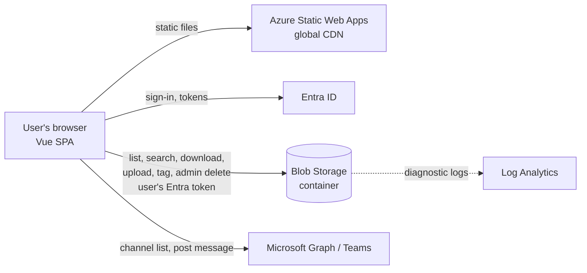
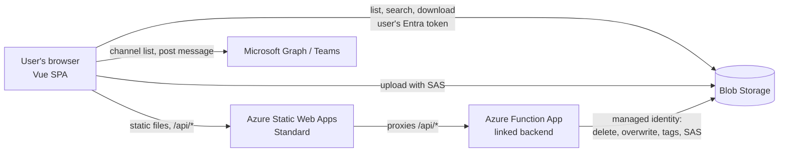

# Architecture

This document describes how the Document Library client is put together: its components, how the browser accesses data, how permissions are enforced, and how the architecture changes when the backend API is added in Phase 2.

It builds on [requirements.md](requirements.md). Hosting, storage configuration, CI/CD and costs are covered in [hosting.md](hosting.md).

---

## Decisions

Decisions pertaining to this part of the App where:

- Due to low cost goals and a pragmatic aproach, existing functionality and infrastructure is being used such as azure blob storage and microsoft logins.
- Granular Permissions for delete functionality moved to Phase 2 as the documents are only confidential towards external entities. Also this keeps costs (implementation as well as running costs) low to start with as there is no need for extra api work.
- To underline this aproach is the easy possibility to expand the project in the future. E.G azure allowes an ocr or even rag approach for searching inside documents should this be a requirment on the future.
- The client will be built using the vue framework. This primarily because it is already well known to the implementation team and is easy to use and expand should this be necessary.

## 1. Overview (Phase 1)

Phase 1 is **frontend-only**: there's no backend API. Everything runs in the browser.



There are two Azure resources per environment (plus Entra ID, which you already have with M365):

| Resource | Purpose |
|----------|---------|
| **Static Web App** | Serves the built Vue app. Runs no code. |
| **Storage account** | Holds the documents in one blob container. Enforces permissions through storage roles. |

Plus one shared **Log Analytics workspace** with Application Insights, for client error logs (NFR-6) and storage logs (NFR-11).

### 1.1 Request flow

1. **Load:** the browser loads the Vue app from Static Web Apps. After that, Static Web Apps isn't involved.
2. **Sign-in:** the app uses MSAL to sign the user in with Entra ID and get tokens for Azure Storage and Microsoft Graph. Static Web Apps' built-in authentication isn't used, because MSAL is needed anyway for those tokens.
3. **Data:** the browser calls Blob Storage directly with the user's Storage token. Azure checks the user's storage role (section 3) on every request.
4. **Teams:** the browser calls Microsoft Graph directly with the user's Graph token, to list channels and post the message.

### 1.2 What this means for security

Permissions are only as fine-grained as the storage roles. Azure stops users from deleting, but it can't tell "your file" from "someone else's file". As a result:
- any user can overwrite any file
- the uploader metadata can be changed by users

Versioning, soft delete and storage logs (see [hosting.md](hosting.md#23-protection-soft-delete-versioning-and-logs)) make every change recoverable and traceable. The backend API in Phase 2 adds per-file rules (section 4).

---

## 2. Data Access

Every storage call comes from the browser, using the user's token:

| Action | SDK call | Who can do it |
|--------|----------|---------------|
| List & name search | `listBlobsFlat({ prefix, includeMetadata, includeTags })` | Users, admins |
| Tag search | `findBlobsByTags("\"invoice\" = '1' AND \"q3\" = '1'")` | Users, admins |
| Download | `download()` / `downloadToBlob` in the browser | Users, admins |
| Upload (with metadata and tags) | `uploadData(file, { metadata, tags, onProgress })` | Users, admins |
| Edit tags | `setTags()` | Users, admins |
| Overwrite | `uploadData()` on an existing name | Users, admins (the UI only offers it to the uploader and admins) |
| Delete | `delete()` | **Admins only**, enforced by Azure |

### 2.1 Data model

Each document is one blob. Its data is split across three places:

| | Holds | Searchable? |
|---|---|---|
| **System properties** | Size, content type, created/modified dates (FR-2.2) | No |
| **Blob name** | The normalised file name (FR-3.7) | Yes, by prefix |
| **Metadata** | `uploaderId`, `uploaderName`, `originalName` (FR-3.4, FR-3.7) | No |
| **Index tags** | Document tags (FR-4) | Yes, via *Find Blobs by Tags* |

**File names:** the browser normalises each file name before upload (FR-3.7) and uses the result as the blob name:

```ts
const normalise = (name: string) => name.normalize("NFC").trim().toLowerCase();

const blobName = normalise(file.name);                     // "q3-report.pdf"
const metadata = {
  originalName: encodeURIComponent(file.name),             // "Q3-Report.PDF", ASCII-safe
  uploaderId, uploaderName: encodeURIComponent(uploaderName),
};
await container.getBlockBlobClient(blobName).uploadData(file, {
  metadata, tags, onProgress,
  blobHTTPHeaders: {
    blobContentType: file.type,
    // Downloads are saved under the original name
    blobContentDisposition: `attachment; filename*=UTF-8''${encodeURIComponent(file.name)}`,
  },
});
```

Search text goes through the same `normalise()` before it's used as the listing prefix, so name search is case-insensitive. The list, the download and the Teams message use the decoded `originalName`. The deep link (FR-2.6) uses the blob name.

**Tag storage:** index tags are key/value pairs, but this app's tags are plain labels. Store each label as the key, with a fixed value: `{ "invoice": "1", "q3": "1" }`. Normalise labels to lower case before saving (FR-4.5), because tag keys and values are case-sensitive.

The limits these choices run into (10 tags per file, allowed characters, ASCII-only metadata, and so on) are listed in [hosting.md](hosting.md#22-limits-that-matter-for-this-project).

---

## 3. Permission Model

Two layers decide what a user can do:

| Layer | Set by | Controls | Enforced by |
|-------|--------|----------|-------------|
| **App role** `DocLibrary.Admin` | Entra ID app registration | Which actions the UI shows | The app only (cosmetic) |
| **Storage role** | Azure role assignment on the storage account | What requests Azure allows | Azure, on every request |

Admins need both, ideally through the same Entra group.

### 3.1 Storage roles

Built-in roles don't fit: *Storage Blob Data Contributor* includes delete, and the tag permissions sit in *Storage Blob Data Owner*. So Phase 1 uses two custom roles, assigned on the storage account (or the container):

| Permission (data action under `Microsoft.Storage/storageAccounts/blobServices/containers/blobs/`) | Document Contributor (all users) | Document Admin |
|---|:---:|:---:|
| `read`: list and download | ✓ | ✓ |
| `write`: upload, overwrite, set metadata | ✓ | ✓ |
| `add/action`: upload in blocks | ✓ | ✓ |
| `tags/read`: read tags | ✓ | ✓ |
| `tags/write`: set tags | ✓ | ✓ |
| `filter/action`: Find Blobs by Tags | ✓ | ✓ |
| `delete`: delete | | ✓ |

Assign Document Contributor to an "all employees" group and Document Admin to the admin group. Confirm the exact data action names when creating the roles, and test each action with a non-admin account in staging before go-live.

Roles apply to the whole container, not to individual files. That's why users can't delete in Phase 1, and why overwrite protection is only a UI rule (NFR-8).

---

## 4. Phase 2: Backend API

The backend API planned for Phase 2 ([requirements.md, section 9.1](requirements.md#91-backend-api)) handles every change to storage. Phase 1 is designed so it can be added without rebuilding the frontend: only the calls that change data move from the browser to the API.



### 4.1 What changes

| | Phase 1 (no API) | Phase 2 (with API) |
|---|---|---|
| User storage role | Document Contributor (read, write, tags) | Document Reader (read, tags read, filter) |
| Upload | Browser, with the user's token | Browser, with a single-file SAS issued by the API |
| Tag edits | Browser | API |
| Delete | Admins only, in the browser | API: uploader or admin |
| Overwrite | UI rule only | API: uploader or admin |
| Uploader metadata | Written by the browser (display only) | Written by the API (trusted) |
| SWA plan | Free or Standard | **Standard** (needed for a linked backend) |

### 4.2 Managed vs. linked functions

Static Web Apps can run an API in two ways:

| | Managed functions | Linked ("bring your own") Function App |
|---|---|---|
| Plan | Free or Standard | **Standard only** |
| Where it runs | Inside SWA, managed for you | A separate Function App you own |
| Managed identity | **Not supported** | Supported |
| Triggers | HTTP only | Any |
| Monitoring | Limited | Full Application Insights |

The API needs a **managed identity** to delete blobs, write tags and create SAS tokens without storing an account key (NFR-1). So the plan is:

- **SWA Standard** plan, for production *and* staging
- a **linked Function App** on the **Flex Consumption** plan in Switzerland North, with a system-assigned managed identity that has *Storage Blob Data Owner* (or a custom role with write, tags, delete and *generate user delegation key*)

When linked, SWA proxies `https://<your-domain>/api/*` to the Function App. The browser only ever calls its own origin, so the API needs no CORS setup. SWA also restricts the Function App so it only accepts traffic that comes through the Static Web App. A Static Web App links to exactly one backend, which is another reason staging keeps its own resources.

> **To verify in an early spike:** the API validates the user's MSAL access token from the `Authorization` header. Confirm this header reaches the linked Function App unchanged. If SWA replaces it, send the token in a custom header (e.g. `X-User-Token`) instead.

**Cheaper alternative:** managed functions on the Free plan would work if the API used a storage connection string kept in app settings. That's cheaper but less secure, gives no SLA, and the key must be rotated by hand. It isn't recommended.

Setup, the deployment workflow and the cost impact are in [hosting.md](hosting.md#4-phase-2-hosting-the-backend-api).
