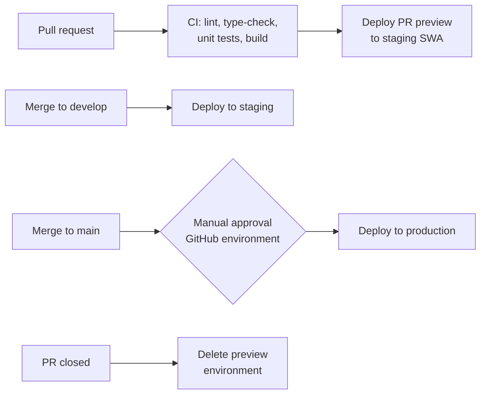

# Hosting, Storage & CI/CD

This document explains how the Document Library client runs on Azure: how Azure Static Web Apps hosts the app, how Azure Blob Storage holds the documents, what limits matter for this project, what it all costs, and how code gets from GitHub to production.

Phase 1 is **frontend-only**: there's no backend API. The components, data access and permission model are described in [architecture.md](architecture.md). Section 4 covers hosting the backend API added in Phase 2.

It builds on [requirements.md](requirements.md). Prices are Azure list prices in **CHF**, excluding VAT, taken from the [Azure Retail Prices API](https://prices.azure.com/api/retail/prices) in November 2026. Storage runs in **Switzerland North** (Zurich). Static Web Apps isn't offered in a Swiss region, so its prices are for West Europe; they're the same in every European region. Enterprise or CSP agreements may give different prices.

**Data residency:** documents, tags and metadata stay in Switzerland North. Only the Vue app's static files (no documents) are served from Static Web Apps' global edge network, and its resource is registered in West Europe. Teams messages go through Microsoft 365, in your tenant's M365 region.

---

## 1. Azure Static Web Apps

### 1.1 How it works

Azure Static Web Apps (SWA) hosts static files (HTML, JS, CSS) and serves them from a globally distributed edge network. For this project:

1. **Build:** `vite build` turns the Vue app into static files in `dist/` (see section 3).
2. **Deploy:** GitHub Actions uploads `dist/` to SWA. Each deployment replaces the previous one in one step, so users never see a half-deployed app.
3. **Serve:** a user opens `https://<your-domain>/`. SWA returns `index.html` and the JS bundles from the edge location closest to them. From then on, the Vue app runs entirely in the browser.
4. **Sign-in:** the app uses MSAL to sign the user in with Entra ID and get tokens for Storage and Graph. SWA's own built-in authentication isn't used, because MSAL is needed anyway for Storage and Graph tokens.
5. **Data:** the browser talks to Blob Storage and Microsoft Graph directly with the user's tokens. SWA isn't involved after the app has loaded.

### 1.2 Plans: Free vs. Standard

With no API, both plans can host Phase 1:

| | Free | Standard |
|---|---|---|
| Price | CHF 0 | CHF 7.47/month per app |
| SLA | None | 99.95% |
| Custom domains | 2 | 5 |
| Preview environments | 3 | 10 |
| App size | 250 MB | 500 MB |
| Bandwidth included | 100 GB/month | 100 GB/month, then CHF 0.166/GB |
| Linked backend (needed in Phase 2) | No | Yes |

**Recommendation:** production on **Standard**, for the SLA; staging on **Free**. If an SLA isn't needed, production can run on Free as well, which cuts the bill to under CHF 1/month. Upgrading later is a setting change with no redeploy.

### 1.3 Environments

Staging and production are **separate sets of resources**, so testing never touches real documents:

| Environment | Resources | SWA plan | How it's deployed | URL |
|-------------|-----------|----------|-------------------|-----|
| Production | `swa-doclib-prod`, `stdoclibprod` | Standard | Push to `main` (after approval) | Custom domain, e.g. `docs.contoso.com` |
| Staging | `swa-doclib-staging`, `stdoclibstaging` | Free | Push to `develop` | The staging app's default URL, e.g. `https://<name>.azurestaticapps.net` |
| PR previews | Preview environments of the **staging** Static Web App | (Free: max 3 at once) | Opened automatically for each pull request, deleted when it closes | `https://<name>-<pr#>.<region>.azurestaticapps.net` |

**Sign-in on preview URLs:** Entra ID needs every redirect URI registered in advance, and doesn't accept wildcards for SPAs. A PR preview's URL changes with each PR number, so sign-in won't work there unless the URI is added. Options:
- Register the production and staging URLs only, and use PR previews just for visual review. *(Recommended.)*
- Have the pipeline add and remove each preview's redirect URI through Graph. This works, but it gives the pipeline permission to change the app registration.

### 1.4 Configuration

All settings (client ID, tenant ID, storage account URL, container name, app URL) are compiled into the JS bundle at build time. Vite reads them from `VITE_*` environment variables, which the pipeline sets from GitHub environment variables (section 3.3). None of them are secrets: anyone can read them in the browser, and that's fine, because every request still needs the user's own sign-in.

SWA's "application settings" in the portal only apply to an API, so Phase 1 doesn't use them.

### 1.5 Custom domain & TLS

Add the domain under *Custom domains* in the SWA resource, then create a CNAME record (for subdomains) or a TXT record plus an ALIAS/A record (for apex domains). SWA issues and renews the TLS certificate for free.

### 1.6 Hosting cost

| Item | Monthly cost |
|------|-------------:|
| Static Web Apps, production, Standard plan (West Europe) | CHF 7.47 |
| Static Web Apps, staging, Free plan | CHF 0 |
| SWA bandwidth (well under the 100 GB included) | CHF 0 |
| Application Insights & Log Analytics (5 GB/month free, then CHF 2.73/GB) | CHF 0 |
| Custom domain TLS certificate | CHF 0 |
| **Hosting total** | **≈ CHF 7.50** |

The domain itself is registered and paid for outside Azure.

---

## 2. Azure Blob Storage

### 2.1 How it works

Blob Storage organises data in three levels:

```
Storage account          stdoclibprod                  (name is unique across Azure; sets the URL)
└── Container            documents                     (like a top-level folder; Phase 1 has one)
    └── Blob             Q3-report.pdf                 (one file, plus its properties, metadata and tags)
```

Each blob has its own URL: `https://stdoclibprod.blob.core.windows.net/documents/Q3-report.pdf`.

The container is **private**: there's no anonymous access. In Phase 1, every request carries the signed-in user's **Entra ID token**, and Azure checks it against the user's storage role (see [architecture.md](architecture.md#31-storage-roles)) before allowing the request.

Each blob carries three kinds of extra data, which this project uses as follows:

| | What it is | Used for | Searchable? |
|---|---|---|---|
| **System properties** | Size, content type, created/modified dates | List columns (FR-2.2) | No |
| **Metadata** | Free-form name/value pairs | `uploaderId`, `uploaderName`, `originalName` (FR-3.4, FR-3.7) | No |
| **Index tags** | Key/value pairs held in a separate, queryable index | Document tags (FR-4) | Yes, via *Find Blobs by Tags* |

**Uploads:** files are uploaded as *block blobs*. The `@azure/storage-blob` SDK splits large files into blocks, uploads several in parallel, reports progress (FR-3.2) and commits them together. A file only appears once it's fully committed, so a half-finished upload never shows in the list.

**Access tier:** all documents go in the **Hot** tier, because users open them often and Hot has the cheapest reads. Cool, Cold and Archive are cheaper to store but charge more per read and have minimum storage periods, so they don't fit this use.

**Redundancy:** **LRS** (three copies in one datacentre) is enough for Phase 1. ZRS (spread across zones) or GRS (copied to a second region) cost more for capacity, but at 15 GB that's still under CHF 1/month.

### 2.2 Limits that matter for this project

| Limit | Value | Impact |
|-------|-------|--------|
| **Index tags per blob** | 10 | Sets FR-4.1's maximum. More tags would need a separate metadata store (Phase 2). |
| **Tag key length** | 1–128 characters | Tag labels are limited to 128 characters. |
| **Tag value length** | 0–256 characters | Not a concern, since values are always `1`. |
| **Allowed tag characters** | Letters, digits, space, and `+ - . / : = _` | Labels containing other characters (e.g. `&`, `#`, `ä`) are rejected. The UI must validate them (FR-4). |
| **Tag query operators** | `AND` only, no `OR` | Selecting several tags shows files that have *all* of them. "Any of these tags" needs one query per tag, merged in the browser. |
| **Tag index delay** | New or changed tags can take a short time to appear in search | A file tagged a moment ago may briefly not appear in tag search. Plain listing still shows it. |
| **Prefix search is case-sensitive** | `report` doesn't match `Report.pdf` | Handled by normalising file names to lower case on upload (FR-3.7) and normalising the search text the same way (FR-5.2). The original name is kept in metadata for display. |
| **List page size** | Up to 5,000 blobs per call | Paging (FR-2.4) uses the continuation token. At ~3,000 files, everything fits in one page. |
| **Metadata size** | 8 KB per blob | Plenty for uploader fields. |
| **Blob name** | Up to 1,024 characters, case-sensitive | Normalising names (FR-3.7) means two files can no longer differ only in case. |
| **Metadata values** | ASCII only | The original file name may contain characters like `ä`, so it's URL-encoded before it's stored in `originalName` and decoded for display. |
| **Max file size** | ~190 TiB per block blob | Not a limit in practice; the configured upload limit (FR-3.6) applies first. |
| **Request rate** | ~20,000 requests/second per account | Far above this project's needs. |
| **Role granularity** | Roles apply to the whole container, not to individual files | Azure can't enforce "your own files". That's why users can't delete in Phase 1, and why overwrite protection is only a UI rule (NFR-8). |
| **CORS** | Must be set on the account | Allow the production and staging origins, methods `GET, PUT, HEAD, DELETE, OPTIONS`, and the `x-ms-*` headers (NFR-2). |

### 2.3 Protection: soft delete, versioning and logs

With no API, these settings are what make mistakes recoverable and traceable (FR-6.4, NFR-11):

- **Soft delete (14 days):** a deleted file can be restored in the portal for 14 days.
- **Blob versioning:** every overwrite keeps the previous version automatically, so a file replaced by mistake can be rolled back. Add a lifecycle rule to delete versions older than e.g. 90 days, so storage doesn't grow without limit.
- **Diagnostic logs:** send `StorageWrite` and `StorageDelete` logs to Log Analytics. Each entry records the caller's Entra identity, so you can see who uploaded, overwrote or deleted each file. Keep the logs for at least 90 days.

### 2.4 Storage cost

| Meter | Rate (Hot, LRS, Switzerland North) | At baseline (30 users, 3,000 files, 15 GB) |
|-------|------------------------|--------------------:|
| **Capacity** | CHF 0.0179 per GB per month (first 50 TB) | CHF 0.27 |
| **Write operations** (upload, set tags, delete) | CHF 0.0448 per 10,000 | < CHF 0.02 |
| **List operations** (listing, Find Blobs by Tags) | CHF 0.0448 per 10,000 | < CHF 0.03 |
| **Read operations** (downloads, properties) | CHF 0.0036 per 10,000 | < CHF 0.01 |
| **Index tags** | CHF 0.0356 per 10,000 tags per month | CHF 0.05 (~15,000 tags) |
| **Data transfer out** (downloads to users) | First 100 GB/month free across the subscription, then CHF 0.0722/GB | CHF 0 unless users download more than 100 GB/month |
| Soft delete & versioning | Kept versions and deleted files, billed as capacity | < CHF 0.10 |
| Diagnostic logs | A few MB/month; within the 5 GB/month free allowance | CHF 0 |
| **Storage total (production)** | | **≈ CHF 0.50** |

The staging storage account holds only test data and costs a few cents a month.

**How it scales:** capacity dominates as the library grows. Each extra 100 GB adds about CHF 1.80/month. Operations stay negligible unless the app lists the whole container far more often than expected, so the browser should cache the list instead of reloading it on every keystroke (FR-5.5).

---

## 3. CI/CD with GitHub Actions

### 3.1 Overview

The code lives on GitHub, so GitHub Actions builds, tests and deploys everything:



Suggested repository layout:

```
/src        Vue 3 + Vite frontend (includes public/staticwebapp.config.json)
/infra      Bicep templates for SWA, storage, custom roles, logging
/.github/workflows
    web.yml     build, test and deploy the frontend
    infra.yml   deploy Bicep (manual trigger)
```

The `/api` folder and its workflow are added in Phase 2 (section 4).

### 3.2 Authentication from GitHub to Azure

There are two credentials, and no long-lived Azure passwords:

| Target | Credential | Stored as |
|--------|-----------|-----------|
| Static Web App | SWA deployment token (from the portal, *Manage deployment token*) | GitHub secret `AZURE_STATIC_WEB_APPS_API_TOKEN`, one per environment |
| Infrastructure (Bicep) | **OIDC federated credential**: GitHub proves its identity to Entra ID and receives a short-lived token, so no secret is stored | GitHub variables `AZURE_CLIENT_ID`, `AZURE_TENANT_ID`, `AZURE_SUBSCRIPTION_ID` |

For OIDC, create an Entra app registration (or user-assigned managed identity) for the pipeline. Add federated credentials for `repo:<org>/<repo>:environment:staging` and `repo:<org>/<repo>:environment:production`. Because the templates create role assignments, the pipeline needs *Contributor* plus *Role Based Access Control Administrator* on the resource group.

### 3.3 GitHub Environments

Create `staging` and `production` environments in the repository settings:
- Each holds its own `VITE_*` variables and SWA deployment token.
- `production` requires a reviewer's approval before a job runs, and only accepts deployments from `main`.

### 3.4 Frontend workflow (`web.yml`)

The workflow builds the app itself, so lint and tests run on exactly what ships. It then uploads the prebuilt `dist/` folder, with `skip_app_build: true` so SWA doesn't build it again.

```yaml
name: web

on:
  pull_request:
    types: [opened, synchronize, reopened, closed]
    paths: ["src/**", ".github/workflows/web.yml"]
  push:
    branches: [develop, main]
    paths: ["src/**", ".github/workflows/web.yml"]

jobs:
  build-and-deploy:
    if: github.event_name == 'push' || github.event.action != 'closed'
    runs-on: ubuntu-latest
    environment: ${{ github.ref == 'refs/heads/main' && 'production' || 'staging' }}
    defaults:
      run:
        working-directory: src
    steps:
      - uses: actions/checkout@v4

      - uses: actions/setup-node@v4
        with:
          node-version: 24
          cache: npm
          cache-dependency-path: src/package-lock.json

      - run: npm ci
      - run: npm run lint
      - run: npm run type-check
      - run: npm run test:unit -- --run

      # End-to-end tests against mock mode (no M365 or Azure needed)
      - run: npx playwright install --with-deps chromium
      - run: npm run test:e2e
      - uses: actions/upload-artifact@v4
        if: failure()
        with:
          name: playwright-report
          path: src/playwright-report

      - run: npm run build
        env:
          VITE_TENANT_ID: ${{ vars.VITE_TENANT_ID }}
          VITE_CLIENT_ID: ${{ vars.VITE_CLIENT_ID }}
          VITE_STORAGE_URL: ${{ vars.VITE_STORAGE_URL }}
          VITE_CONTAINER: ${{ vars.VITE_CONTAINER }}
          VITE_APP_URL: ${{ vars.VITE_APP_URL }}

      - name: Deploy to Static Web Apps
        uses: Azure/static-web-apps-deploy@v1
        with:
          azure_static_web_apps_api_token: ${{ secrets.AZURE_STATIC_WEB_APPS_API_TOKEN }}
          repo_token: ${{ secrets.GITHUB_TOKEN }}   # posts the preview URL on the PR
          action: upload
          app_location: src/dist
          api_location: ""                          # no API in Phase 1
          skip_app_build: true

  close-preview:
    if: github.event_name == 'pull_request' && github.event.action == 'closed'
    runs-on: ubuntu-latest
    environment: staging
    steps:
      - uses: Azure/static-web-apps-deploy@v1
        with:
          azure_static_web_apps_api_token: ${{ secrets.AZURE_STATIC_WEB_APPS_API_TOKEN }}
          action: close
          app_location: ""
```

How each trigger behaves:
Each GitHub environment holds the deployment token of its own Static Web App, so the same job deploys to whichever app the environment points at.

- **Pull request:** runs the checks, deploys a preview of the staging app, and the action comments the preview URL on the PR. Closing the PR deletes the preview. The staging app is on the Free plan, so at most 3 previews can exist at once.
- **Push to `develop`:** deploys to the staging Static Web App.
- **Push to `main`:** waits for approval, then deploys to the production Static Web App.

### 3.5 Infrastructure as code (`infra.yml`)

Keep the Azure resources in Bicep under `/infra`, deployed by a manually triggered workflow (`workflow_dispatch`) with the OIDC login:

```bash
az deployment group create \
  --resource-group rg-doclib-<env> \
  --template-file infra/main.bicep \
  --parameters infra/<env>.bicepparam
```

The templates should cover:
- the Static Web App (Standard for production, Free for staging)
- the storage account: Hot, LRS, private container, CORS, soft delete, versioning and its lifecycle rule
- the two custom storage roles and their group assignments
- diagnostic settings, the Log Analytics workspace and Application Insights

Running the same templates for staging and production keeps the two environments identical, apart from the SWA plan.

### 3.6 CI/CD cost

| Item | Cost |
|------|-----:|
| GitHub Actions minutes | Free for public repos. Private repos get 2,000 minutes/month on GitHub Free and 3,000 on Team. Each run takes about 2–4 minutes, so this project will typically stay within the free minutes. |
| SWA preview environments | Included (3 on the staging app's Free plan) |
| Staging environment | < CHF 0.20/month: a Free-plan Static Web App and a small storage account |

### 3.7 Total monthly cost (Phase 1, production + staging)

| Area | Monthly cost |
|------|-------------:|
| Hosting (section 1.6) | ≈ CHF 7.50 |
| Blob Storage, production (section 2.4) | ≈ CHF 0.50 |
| Staging (section 3.6) | < CHF 0.20 |
| CI/CD | CHF 0 (within free minutes) |
| **Total** | **≈ CHF 8** |

This matches section 5.2 of [requirements.md](requirements.md) and stays well under NFR-10's CHF 20/month cap. With production on the Free plan as well, the total drops below CHF 1/month. All prices exclude Swiss VAT (8.1%).

---

## 4. Phase 2: Hosting the Backend API

This section covers the setup, deployment and cost of the backend API planned for Phase 2 ([requirements.md, section 9.1](requirements.md#91-backend-api)). Its architecture, including why it runs as a linked Function App, is described in [architecture.md](architecture.md#4-phase-2-backend-api).

### 4.1 Additional setup

- Entra app registration: expose an API scope for the backend.
- Function App application settings: storage account name, allowed tenant, admin role name.
- Replace the Document Contributor role assignment with Document Reader for users.
- Bicep: add the Function App, its storage account and the SWA backend link.

### 4.2 API workflow (`api.yml`)

```yaml
name: api

on:
  pull_request:
    paths: ["api/**", ".github/workflows/api.yml"]
  push:
    branches: [develop, main]
    paths: ["api/**", ".github/workflows/api.yml"]

permissions:
  id-token: write     # needed for OIDC login
  contents: read

jobs:
  build:
    runs-on: ubuntu-latest
    defaults:
      run:
        working-directory: api
    steps:
      - uses: actions/checkout@v4
      - uses: actions/setup-node@v4
        with:
          node-version: 22    # use a Node version the Function App runtime supports
          cache: npm
          cache-dependency-path: api/package-lock.json
      - run: npm ci
      - run: npm run lint
      - run: npm test
      - run: npm run build
      - run: npm prune --omit=dev
      - uses: actions/upload-artifact@v4
        with:
          name: api
          path: api

  deploy:
    if: github.event_name == 'push'
    needs: build
    runs-on: ubuntu-latest
    environment: ${{ github.ref == 'refs/heads/main' && 'production' || 'staging' }}
    steps:
      - uses: actions/download-artifact@v4
        with:
          name: api
          path: api
      - uses: azure/login@v2
        with:
          client-id: ${{ vars.AZURE_CLIENT_ID }}
          tenant-id: ${{ vars.AZURE_TENANT_ID }}
          subscription-id: ${{ vars.AZURE_SUBSCRIPTION_ID }}
      - uses: Azure/functions-action@v1
        with:
          app-name: ${{ vars.FUNCTION_APP_NAME }}
          package: api
          # Check the action's docs for any extra input Flex Consumption needs.
```

PR previews share the staging Function App. If a PR changes the API, test it on staging after merging to `develop`.

### 4.3 Cost impact

| Item | Monthly cost |
|------|-------------:|
| Staging SWA: Free → Standard | + CHF 7.47 |
| Function Apps, Flex Consumption (free grant: 100,000 GB-s and 250,000 executions per month, per subscription) | CHF 0 |
| Storage accounts the Function Apps need for their own deployment packages (production + staging) | < CHF 0.60 |
| **Added per month** | **≈ CHF 8** |
| **Phase 2 total (production + staging)** | **≈ CHF 16** |

That still stays under NFR-10's CHF 20/month cap.
